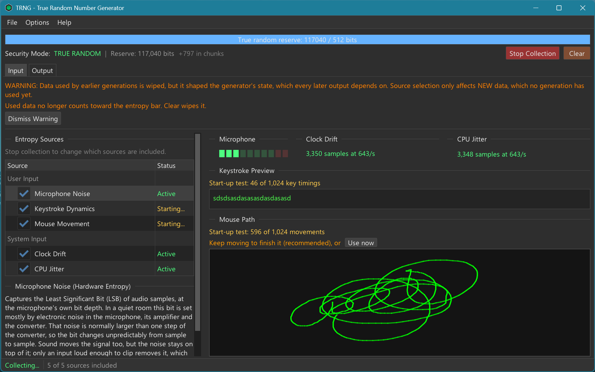
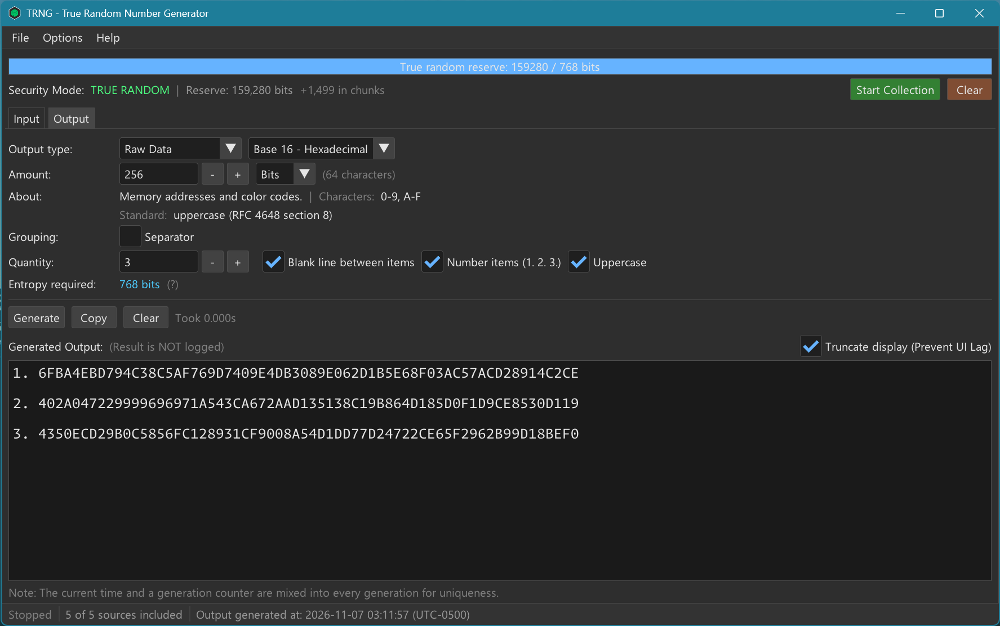

# True Random Number Generator

A desktop application for generating cryptographically secure random numbers using multiple hardware entropy sources. Built with C++ and Dear ImGui for Windows.

- **Measured sources**: every entropy source's credit sits below its min-entropy as measured with **NIST SP 800-90B** on the raw source data ([Measured Source Entropy](#measured-source-entropy-nist-sp-800-90b)).
- **Output tests**: the earlier quad-layer pipeline's output passed 8000 streams of **NIST SP 800-22**, 2 TB of **PractRand** and **TestU01**; the runs for the current HMAC_DRBG generator are still to be done ([Statistical Validation Results](#statistical-validation-results)).

## Contents

- [Overview](#overview)
- [Download](#download)
- [Usage](#usage)
- [Output Formats](#output-formats)
- [Entropy Sources](#entropy-sources)
- [Security Considerations](#security-considerations)
- [Documentation & Standards](#documentation--standards)
- [Statistical Validation Results](#statistical-validation-results)
- [Building](#building)
- [Project Structure](#project-structure)
- [Dependencies](#dependencies)
- [License](#license)

---

## Overview

TRNG collects entropy from physical and system sources (hardware timing, user input and operating system scheduling). It uses it in two ways:
- The first 512 credited bits seed **HMAC_DRBG (SHA-512)**, a deterministic random bit generator from NIST SP 800-90A, whose security is computational.
- Everything collected after that is condensed into a **true random reserve** by a Toeplitz extractor: every 640 credited bits of a source become 512 reserve bits.

The application supports two security modes:
- **TRUE RANDOM**: When the true random reserve covers every byte the output draws, the output is reserve bits XOR HMAC_DRBG output (NIST SP 800-90C RBG3(XOR)). This is true randomness if the sources' credit estimates hold, and never weaker than PSEUDO-RANDOM if they don't.
- **PSEUDO-RANDOM**: When the reserve doesn't cover the output, HMAC_DRBG stretches its seed to the output size. This provides computational security, and needs no new collection once the generator has its 512 bits.

A TRUE RANDOM output takes only the reserve bits it draws; they are wiped, and the rest stay for later outputs (see [Entropy Accounting](#entropy-accounting-and-generator-state)).

### Screenshots

**Input tab:** collecting from all five sources: the source list with each source's status and description, the microphone level, the Clock Drift and CPU Jitter sample rates, and the keystroke preview and mouse path with their start-up tests still running. The bar shows the true random reserve, with the reserve counter next to the mode the next output will use.



**Output tab:** three numbered 256-bit Raw Data values in uppercase hex, generated in TRUE RANDOM mode, with the entropy they required.



---

## Download

Download `TRNG.exe` from the [Releases](https://github.com/Cynid-22/True-Random-Number-Generator/releases) page. It is a single portable file and needs no installation. To build it yourself, see [Building](#building).

### Verifying a Download

Each release has `TRNG.exe`, its SHA-256 checksum `TRNG.exe.sha256`, `TRNG-toolchain.txt` (the compiler, linker and every MSYS2 package version that built it), and a build provenance attestation from the release workflow for both files. Check that the file you downloaded is the one the workflow built:

```powershell
Get-FileHash .\TRNG.exe -Algorithm SHA256
```

The hash must match the one in `TRNG.exe.sha256` (`Get-FileHash` prints it in capitals, the file in lowercase; the letters are the same). With the GitHub CLI, check the attestation too; it must report that the verification succeeded:

```bash
gh attestation verify TRNG.exe --repo Cynid-22/True-Random-Number-Generator
```

Releases published before the checksum and attestation were added have neither.

---

## Usage

1. **Configure Sources**: In the Input tab, tick the entropy sources to include. Click a source to see how it works.
2. **Start Collection**: Click "Start Collection", type on the keyboard and move the mouse inside the Mouse Path box on the Input tab.
3. **Monitor Progress**: Watch the bar fill, first to the 512 bits that seed the generator, then with the true random reserve against what the output draws. Next output shows TRUE RANDOM or PSEUDO-RANDOM, and after you generate, the output header shows the mode that made the output. Above Keystroke Preview, the Microphone level meter and the Clock Drift and CPU Jitter sample counts show those sources recording.
4. **Configure Output**: Select the output format and its parameters in the Output tab.
5. **Generate**: Click Generate when enough entropy is collected.
6. **Copy or Export**: Copy puts the output on the clipboard, kept out of clipboard history and cleared after 60 seconds. File > Export Output (Ctrl+S) saves it to a file (see [Exporting](#exporting)).

---

## Output Formats

Pick a category, then a type within it:

- **Numbers**
  - Decimal (0.0 - 1.0)
  - Integer Range (custom min/max)
- **Raw Data**
  - Amount in bits or bytes, with an optional space every N characters.
  - Base 2 (Binary), Base 8 (Octal), Base 32 Crockford: exact bits
  - Base 16 (Hexadecimal), Base 32 (RFC 4648), Base 45 (RFC 9285), Base 64, Base 64 URL, Base 85 (RFC 1924 alphabet): standard encodings of whole bytes
  - Base 10 (Decimal), Base 12 (Duodecimal), Base 36, Base 58 (Bitcoin), Base 62: uniformly random digits holding at least the requested bits
  - Letters default to the case each standard uses: uppercase for Hex, Base 32, Crockford Base 32 and Base 45. No standard defines a case for Base 12 or Base 36, so they default to lowercase. The Uppercase checkbox switches any of them.
- **Text & Passwords**
  - Random Characters (configurable character set)
  - Passphrase, from a word list of your choice (see [assets/Wordlist_specs.md](assets/Wordlist_specs.md)):
    - NordPass (default): 123,565 words, 16.91 bits/word
    - EFF Large: 7,776 words, 12.92 bits/word; no word starts with another
    - Diceware 8k: 8,192 words, 13 bits/word; short entries with digits and symbols
    - BIP39 English: 2,048 words, 11 bits/word; not a wallet recovery phrase (no BIP39 checksum)
    - Optional random digits at the start or end of words, up to two per word (e.g. `4word-word7-2word`)
- **Identifiers**
  - UUID v4 (RFC 9562, Quantity, optional uppercase/no hyphens)
  - UUID v7 (RFC 9562, timestamp-ordered, same options as v4, plus batch ordering: [Method 1](https://www.rfc-editor.org/rfc/rfc9562.html#section-6.2) dedicated counter with adjustable length, Method 2 monotonic random with adjustable increment, or fully random)
- **Lists**: type or paste your own items.
  - Pick From List: picks **Items to pick** items, each at most once per output unless **Allow repeats** is ticked.
    - **Remove picked items from the list** takes them out of the list box after each Generate.
    - **Shuffle** puts the list box in a random order.
    - The **Advanced** tab shows every item's weight and its chance (weight / total weight, so the chances always add up to 100%). Tick **Use weights** to change them (0 = never picked). A weight belongs to the item's text, so editing the list or changing how it is split keeps it, and it comes back when that item does.
  - Shuffle List: the whole list in a random order (Fisher-Yates), one item per line, or joined with the separator on one line when **One item per line** is unticked.
  - Splitting: one item per line, or untick **One item per line** to split them at a separator of your choice as well as at line breaks. **Trim spaces** ignores spaces around items and the separator. Empty items are always skipped.
  - List box buttons: **Sort A-Z** / **Sort Z-A** sort it in alphanumeric order (case ignored, numbers by value, so `item2` comes before `item10`), **Remove Duplicates** keeps the first copy of each item, and **Clear List** wipes it.
- **Encryption**
  - One-Time Pad (Vernam cipher with a key from the true random reserve XOR HMAC_DRBG; see [Generation Modes](#generation-modes)). It needs TRUE RANDOM mode, and each pad uses up the reserve bits it draws.
    - Text: letters, numbers and spaces. Shows the key and the ciphertext, where ciphertext = (message + key) mod 63 over 0-9 A-Z a-z space; decrypt with message = (ciphertext - key) mod 63
    - Message Length: a pad (key) of a given number of characters, without typing the message
    - File: each byte is XORed with the key; the key and the ciphertext are exported as raw binary files the same size as the original. File names in any language are supported
    - Export Output (Ctrl+S) saves the key and the ciphertext together in one file: .txt, .csv or .json (hex for files) or .bin (see [Exporting](#exporting)). Save the key: without it the ciphertext can't be decrypted

Every type except One-Time Pad and Shuffle List can generate many items at once (**Quantity**, or **Items to pick** for Pick From List), one per line, with optional blank lines between items and numbering (`1.`, `2.`, `3.` ...). Shuffle List uses the same blank-line and numbering options when it puts one item per line.

Picks and shuffles use 8-byte draws with rejection sampling, like every other format, so no item gets an edge from modulo bias, and a list output is TRUE RANDOM when the reserve covers its draws. The list box and the weights are never logged, and they are wiped on Clear List, logoff and exit.

### Exporting

File > Export Output (Ctrl+S) saves the output in the format picked under "Save as type":

- **.txt**: the text as shown.
- **.bin**: the value behind each item instead of its text. Items follow each other with no separators, numbering or blank lines (layout below).
- **.csv**: one item per row under a header with the type's name, every field in double quotes, CRLF line ends (RFC 4180).
  - With numbering on, a `#` column comes first.
  - One-Time Pad: a `key` column and, for Text and File, a `ciphertext` column.
  - The settings and security mode are only in .json.
  - Items that start with `=`, `+`, `-`, `@`, a tab or a carriage return get a leading `'`, so a spreadsheet shows them as text instead of running them as formulas (CSV injection). This covers list items and generated text such as Random Characters, Base64 or Base85 Raw Data and Diceware 8k passphrases; only Integer items, which are plain numbers, keep a leading `-`. The .txt and .json exports keep every item unchanged.
  - Excel still changes some values when it opens a CSV: numbers longer than 15 digits lose digits and leading zeros are dropped. To keep them exact, import with Data > From Text/CSV and set the column type to Text.
- **.json**: the type, its settings, the security mode and the generation time, then the items as an array of strings. One-Time Pad: `key` and, for Text and File, `ciphertext`. For the Lists types, the settings hold the number of items and the split options, never the items of the list box.

In .txt, .csv and .json, One-Time Pad File results are written as hex. When the output box shows an error or a cancelled generation, only .txt is offered.

Example .json export:

```json
{
  "app": "TRNG",
  "version": "2.0.0",
  "category": "Identifiers",
  "type": "UUID v4",
  "settings": {
    "quantity": 2,
    "uppercase": false,
    "hyphens": true
  },
  "securityMode": "TRUE RANDOM",
  "generatedAt": "2026-10-19 14:03:22 (UTC+0700)",
  "items": [
    "0f8e2c4a-6b1d-4e3f-9a7c-5d2b8e1f4a6c",
    "7c3a9e5f-2d8b-4c1e-b6a4-9f0d3e7b2c5a"
  ]
}
```

Layout of the .bin export:

| Type | Each item in the .bin file |
|------|----------------------------|
| Decimal | One byte per digit after `0.`, 0 to 9 |
| Integer Range | 8-byte signed integer, little-endian |
| Raw Data: Base 16, Base 32 (RFC 4648), Base 45, Base 64, Base 64 URL, Base 85 | The bytes the text encodes |
| Raw Data: Base 2, Base 8, Base 32 Crockford | The bits the text shows, first bit in the high bit of the first byte, zero-padded to a whole byte |
| Raw Data: Base 10, 12, 36, 58, 62 | One byte per digit: its position in the encoding's alphabet |
| Random Characters | One byte per character: its position in the character set (the ticked groups in the order numbers, uppercase, lowercase, special; each group in ASCII order) |
| Passphrase | 4 bytes per word, little-endian: its position in the selected word list (0 = first word). With Numbers above 0, then one byte per spot, two per word (start, then end): the digit 0-9, or 255 for no digit |
| UUID v4 / v7 | The 16 bytes in RFC 9562 order |
| Pick From List | 4 bytes per pick, little-endian: the picked item's position in the list (0 = first item, empty items not counted) |
| Shuffle List | 4 bytes per item, little-endian: each item's position in the original list, in the shuffled order |
| One-Time Pad: Text | The key, then the ciphertext, one byte per character as 0-62 (0-9 = 0-9, A-Z = 10-35, a-z = 36-61, space = 62) |
| One-Time Pad: Message Length | The key, one byte per character as 0-62 |
| One-Time Pad: File | The key bytes, then the ciphertext bytes |

---

## Entropy Sources

### User Input Sources

| Source | Method | Data Collected |
|--------|--------|----------------|
| **Microphone** | Electronic Noise | Least Significant Bit (LSB) of each audio sample of the first channel, at the microphone's own bit depth (the device format Windows reports, up to 24 bits), from Windows' raw stream with sound enhancements skipped when the driver supports it |
| **Keystroke** | Timing Analysis | Flight Time (gap between keys) and Dwell Time (key hold duration) in nanoseconds, read through Windows Raw Input on a dedicated thread, so each time is taken the moment the key arrives; Windows only passes keys to TRNG while its window is in front; auto-repeat and keys sent by software are ignored |
| **Mouse** | Movement Tracking | The sensor's raw movement counts through Windows Raw Input, before pointer speed and acceleration (for a precision touchpad, the movement Windows derives from the finger), summed into at most one sample every 7 ms while the pointer is over the Mouse Path box and TRNG is in front; movement sent by software is ignored, and touchpad movement counts only while the touchpad reports a finger on it |

### System Input Sources

| Source | Method | Data Collected |
|--------|--------|----------------|
| **Clock Drift** | Timer Wake-up Latency | CPU cycle counter ticks that pass while the thread waits for a 1 ms Windows timer; the counter runs at a fixed rate, so the count varies with how late the wake-up comes (timer hardware, interrupts, scheduling, CPU power states) |
| **CPU Jitter** | Thread Timing | How far a counter, incremented nonstop by one thread, moves between wake-ups of a second thread that samples it about every millisecond; varies with the wake-up time and with how fast the counting thread runs in between (interrupts, other programs, clock speed changes) |

What exactly is unpredictable in each source, what an attacker could observe or influence, and why each credit cap is safe: [Stochastic Models of the Entropy Sources](docs/stochastic_models.md).

### Entropy Estimate

The entropy bar credits each source conservatively, per sample:

| Source | Credit (at most) | Based on |
|--------|------------------|----------|
| **Microphone** | 8 bits per 64 LSBs | How balanced the ones and zeros are, and how balanced the bit changes are |
| **Keystroke** | 2 bits per flight or dwell time | The smallest of the time, its change from the last one, and the change of that change |
| **Mouse** | 1 bit per recorded movement (at most one every 7 ms) | The smallest of the movement, its change and the change of that change; the position itself is not credited, so a steady straight line counts for nothing |
| **Clock Drift** | 1 bit per sample | The smallest of the change in the measured cycle count from one sample to the next, and the change of that change |
| **CPU Jitter** | 1 bit per sample | The smallest of the count, its change and the change of that change |

- **Repeats**: a value that repeats one of the source's last 8 values gets no credit.
- **Health tests**: each source runs the NIST SP 800-90B repetition count and adaptive proportion health tests (false alarm rate 2^-20, 512-sample window, cutoffs computed from the source's credit per sample). A source that fails gets no more credit and shows **Failed**: the reserve chunk it was filling is wiped and dropped, and its data is still hashed into the generator's seed, uncredited, until you choose **Turn off** (nothing from it is credited or hashed) or **Test again** (its full start-up test runs again).
- **Start-up test**: each time collection starts, every source runs a start-up test (SP 800-90B 4.3): its first 1,024 samples go through both health tests before any of its credit counts. The samples and their credit are held during the test and no generation uses them; when the test passes they go to the generator's seed or the reserve, and if it fails they go into the generator's seed uncredited.
- **Use now**: Keystroke and Mouse can be released early, after 64 and 512 samples, with **Use now**, once the enabled system and microphone sources have passed their own start-up tests. Finishing the full test is recommended, since credit released early can be used before the full test would have caught a faulty device. The choice is not remembered between collections.
- **Virtual machines**: in a virtual machine, Clock Drift and CPU Jitter earn no credit: their timing comes from the virtual machine's view of the CPU, which the host controls. Their data is still hashed into the seed. TRNG detects a virtual machine through the CPU's hypervisor flag; Windows running on Hyper-V for Memory Integrity, WSL2 or Hyper-V itself is recognised as the host and keeps full credit. A hypervisor built to hide itself is not detected.
- **Timestamps**: every value is stamped in 64-bit nanoseconds from a steady clock, which only moves forward and is not changed by clock adjustments or time sync (usually in 100 ns steps). The timestamp sorts the values in time order and gives the keystroke timings and the mouse's 7 ms window. It is hashed into the generator's seed with each value that seeds it, but it is never credited, and the reserve's extractor takes the values only.

### Measured Source Entropy (NIST SP 800-90B)

Each source's raw values (recorded with the [Sample Export test build](#sample-export-test-build), before any hashing) were measured with NIST's [SP800-90B_EntropyAssessment](https://github.com/usnistgov/SP800-90B_EntropyAssessment) tool: `ea_non_iid -i -a` for the min-entropy, and `ea_restart` (1,000 restarts × 1,000 symbols) for the sources that run by themselves. Measured on 2026-10-21 on a Windows 11 laptop, on bare metal.

| Source | Samples | Min-entropy (H_I) | Credit needs | Restart test (validated H) | Credit |
|---|---|---|---|---|---|
| Microphone (built-in, raw stream, 16-bit) | 32,163,328 LSBs | 0.875 per LSB | 0.125 | Passed (0.844) | Holds, 6.8× margin |
| Clock Drift | 1,106,127 | 4.733 per 8-bit symbol | 1 | Passed (4.733) | Holds, 4.7× margin |
| CPU Jitter | 1,105,336 | 7.188 per 8-bit symbol | 1 | Passed (7.188) | Holds, 7.2× margin |
| Keystroke | 3,883 timings | 3.278 per 8-bit symbol | 2 | Not applicable | Holds, 1.6× margin |
| Mouse (1,000 Hz mouse) | 8,902 | 1.750 per 8-bit symbol | 1 | Not applicable | Holds, 1.75× margin |
| Mouse (precision touchpad) | 14,291 | 1.657 per 8-bit symbol | 1 | Not applicable | Holds, 1.66× margin |

- Every credit cap is below the measured min-entropy, so the caps were kept as they are; none is ever set above its measurement.
- The microphone discards its first 500 ms after each start: without it, the restart test showed its LSBs correlated for about 175 ms while the input settles.
- Keystroke and mouse are human input: their recordings are far below the standard's 1,000,000 samples, and the restart test does not apply. Their credit is kept well below the measurement for that reason.
- These measurements are for this machine. Other hardware, virtual machines and other microphones can measure differently.
- The model behind each source and the reasoning for each cap are in [docs/stochastic_models.md](docs/stochastic_models.md).

---

## Security Considerations

### Minimum Entropy Requirement

The application enforces a **512-bit minimum** for all output generation, regardless of the selected format: the generator must have received at least 512 bits of credited entropy from the ticked sources (its unused seed data plus entropy used by earlier generations in the session). Until then, all credited data goes to the generator. If the ticked sources hold less than that when the generator is created (for example after unticking the source that supplied its seed), it is seeded with 512 bits from the ticked sources' true random reserve instead; those bits are never XORed into output. This ensures a baseline level of security even for small outputs. The 512 bits are needed once per session, not per output.

### Screen Capture

The TRNG window is kept out of screenshots, screen recordings, screen sharing and Windows Recall (`SetWindowDisplayAffinity`), so they keep no copy of a generated secret. Windows 10 version 2004 and later leave the window out; older versions show it as black. To take a screenshot of TRNG, tick **Options > Allow Screen Capture**; the status bar then shows "Screen capture allowed" until you untick it. If Windows refuses to hide the window, the status bar shows "Screen capture not blocked". A camera pointed at the screen, or a program with administrator rights, can still see it.

### Cryptographic Architecture

```
                 +--------------------------------------------+
                 | SOURCES: microphone, keystrokes, mouse,    |
                 | Clock Drift, CPU Jitter                    |
                 +--------------------------------------------+
                                        |
                                        v
                 +--------------------------------------------+
                 | ENTROPY POOL, per source                   |
                 | - credit below the measured min-entropy    |
                 | - SP 800-90B start-up and online tests     |
                 | - software and repeated input dropped      |
                 | - no timing credit under a VM              |
                 +--------------------------------------------+
                   |                                         |
   first 512 bits  |                                         | everything after
                   v                                         v
PIPELINE 1: GENERATOR                     PIPELINE 2: RESERVE
+------------------------------------+    +------------------------------------+
| SP 800-90A HMAC_DRBG (SHA-512)     |    | Each source fills its own chunk    |
|                                    |    | to >= 640 credited bits            |
| Created, then reseeded at every    |    |           |                        |
| generation and every 64 MiB, with: |    |           v                        |
|   new seed data from the sources   |    | Toeplitz extractor (no hash):      |
|   + time, generation counter       |    |   640 credited bits -> 512 bits    |
|   + Windows RNG (not credited)     |    | chunk wiped after use, dropped     |
|                                    |    | if its source fails a test         |
| State K + V, 256-bit strength,     |    |           |                        |
| rewritten after every request      |    |           v                        |
| of at most 64 KiB                  |    | TRUE RANDOM RESERVE                |
|                                    |    |   locked memory, grows as you      |
| Reseeded from the reserve: 256     |<---|   collect (512 bits per 640        |
| bits per 16 KiB of TRUE RANDOM     |    |   credited bits)                   |
| output                             |    |                                    |
+------------------------------------+    +------------------------------------+
                   | generator output                        | reserve bits
                   v                                         v
+------------------------------------------------------------------------------+
| MODE DECISION, per output                                                    |
|                                                                              |
| Generator has its 512 bits (from the sources, or from the reserve            |
| if the ticked sources hold too little)? If not: blocked.                     |
| Does the reserve cover every byte the output draws, rejected                 |
| draws included?                                                              |
+------------------------------------------------------------------------------+
                   | no                                      | yes
                   v                                         v
+------------------------------------+    +------------------------------------+
| PSEUDO-RANDOM                      |    | TRUE RANDOM                        |
|                                    |    |                                    |
| output = generator output          |    | output = reserve bits XOR          |
| - 256-bit computational strength   |    |          generator output          |
| - no new collection needed         |    |          (SP 800-90C RBG3(XOR))    |
|                                    |    | - used reserve bits wiped          |
|                                    |    | - never weaker than PSEUDO-RANDOM  |
+------------------------------------+    +------------------------------------+
                   |                                         |
                   +-----------------------------------------+
                                        v
              +--------------------------------------------------+
              | FORMAT: password, passphrase, UUID, Raw Data,    |
              | One-Time Pad (TRUE RANDOM only), ...             |
              +--------------------------------------------------+
                                        v
                                     OUTPUT
```

**Pipeline 1: HMAC_DRBG (SHA-512).** One instance per session, as specified in NIST SP 800-90A Rev. 1:

1.  **Instantiate**: the first generation creates the generator from its seed data (entropy input), a nonce (wall-clock time, generation counter, process id) and a fixed personalization string.
2.  **Reseed**: every later generation reseeds it with any new seed data collected since the previous one. During a long output it is also reseeded every 64 MiB with the seed data collected since the last reseed. Used data is wiped afterwards.
3.  **Generate**: output is produced in requests of at most 64 KiB. The first request of each generation takes the settings, time and generation counter as additional input, so two generations never share output. After every request the generator rewrites its state, so a later copy of memory can't recover earlier output.

The security strength is 256 bits. The generator's state (1,024 bits) is kept in locked memory and wiped on Clear, logoff and exit.

**Pipeline 2: the true random reserve.** Once the generator has its 512 bits, each source's data fills chunks. A chunk with at least 640 credited bits is condensed by a **Toeplitz extractor** into 512 reserve bits and then wiped. By the leftover hash lemma, those bits are within 2^-65 of uniform (averaged over the extractor's public seed) if the credit holds. The extractor uses no hash function, so a break in SHA-2 can't affect it. Its seed is 257 pulses of the NIST Randomness Beacon. The bound, the seed and the rules are in [docs/stochastic_models.md](docs/stochastic_models.md#the-true-random-reserve).

**Self-tests**: at launch, SHA-512, HMAC-SHA-512, HMAC_DRBG and the Toeplitz extractor are checked against known answers (FIPS 180-4, RFC 4231, NIST CAVP, and an independent reference computation for the extractor). If one fails, generating is turned off.

### Generation Modes

| Collected Entropy | Mode | Security Level |
|-------------------|------|----------------|
| Generator seed < 512 bits and reserve < 512 bits | Blocked | Generation disabled |
| Generator seeded, reserve doesn't cover the output | PSEUDO-RANDOM | Computational (HMAC_DRBG, 256-bit strength) |
| Generator seeded, reserve covers every byte the output draws | TRUE RANDOM | Reserve bits XOR HMAC_DRBG output: true randomness if the credit estimates hold, never weaker than PSEUDO-RANDOM |

A TRUE RANDOM output follows the RBG3(XOR) construction of NIST SP 800-90C:
- "Every byte the output draws" includes draws that rejection sampling throws away. A 16-digit Decimal, for example, draws 64 bytes for about 53 bits of entropy, while 256 bits of Raw Data in Hex draw exactly 32 bytes.
- Data that seeds the generator never goes into the reserve, and reserve bits used for the XOR never seed the generator.
- During a TRUE RANDOM output, the generator is reseeded with 256 reserve bits after every 16 KiB it produces (SP 800-90C 6.4.2); the bar counts those bits too.
- There is never a partly covered output. In the rare case that an Integer output's extra draws find the reserve empty, the whole output is made again as PSEUDO-RANDOM.

The One-Time Pad always uses TRUE RANDOM mode: its key is a true one-time pad if the sources' credit estimates hold, and still as strong as HMAC_DRBG if they don't. Not certified: SP 800-90C's RBG3 calls for validated physical entropy sources, so TRNG is designed after it, not compliant with it.

### Entropy Accounting and Generator State

- The entropy bar first shows the credited bits for the generator's seed against the 512-bit minimum. Once that is met, or the ticked reserve holds 512 bits that can seed the generator instead, it shows the true random reserve of the ticked sources against the bits the configured output would draw.
- Each source keeps its own reserve, and an output draws only from the ticked sources' reserves. Every 512 reserve bits cost 640 credited bits, so about 20% of the credit goes to condensing. Up to 639 credited bits per source wait in an unfinished chunk until it fills.
- A TRUE RANDOM output takes only the reserve bits it draws. They are wiped and never handed out again; the rest stay for later outputs.
- **Next output** shows the mode the next generation will use. Next to it, a counter shows the reserve of the ticked sources and the credited bits still waiting in unfinished chunks.
- The header above a generated output shows the mode that made that output ("Made in TRUE RANDOM" or "Made in PSEUDO-RANDOM"). It can differ from Next output, for example once a TRUE RANDOM output has used the reserve up.
- Seed data used by a generation reseeds the generator and is then wiped. The generator's state carries its effect into every later output, but reading memory later doesn't reveal the data behind earlier outputs.
- A generation works on a copy of the generator and of the reserve bits it may need. A cancelled or failed generation uses nothing up and leaves both as they were.
- **Clear** wipes the data, the credit, the reserve and the generator; the next generation creates a new one. A generation in progress is cancelled, so no output made from the cleared data is shown.
- Each time the generator is created or reseeded, 64 bytes from Windows' own random generator (BCryptGenRandom) are mixed in. They are never credited: they don't count toward the entropy bar, the modes or the One-Time Pad, they never enter the reserve, and the program works the same if Windows can't supply them.
- The additional input of each generation holds the current time and a per-process generation counter, so two generations never share it.

### Design Classes

TRNG is designed after the random number generator classes of BSI AIS 20/31. It is not certified or evaluated against them.

| Part | Designed after | How |
|------|----------------|-----|
| Entropy sources | NTG.1 (non-physical true RNG) | Mostly non-physical sources (user input, operating system timing), each with a stochastic model, conservative credit, start-up and online health tests, and a total-failure reaction (a failing source's chunk is dropped) |
| Pipeline 1, PSEUDO-RANDOM | DRG.4 (hybrid deterministic RNG) | HMAC_DRBG rewrites its state after every request, so a later copy of memory can't recover earlier output, and is reseeded with new data at every generation and every 64 MiB |
| Pipeline 2, TRUE RANDOM | PTG.3 and NIST SP 800-90C RBG3(XOR) | Entropy source with online tests, then cryptographic post-processing with memory (the XOR with HMAC_DRBG), so the output stays as strong as the generator if the sources fail. PTG.3 assumes a physical noise source, and only the microphone is one, so this follows its structure, not its class |

More on memory wiping, text inputs, release integrity and known limitations: [SECURITY.md](SECURITY.md).

---

## Documentation & Standards

| Component | Standard | Authority |
|-----------|----------|-----------|
| Hashing | FIPS 180-4 | NIST |
| HMAC | FIPS 198-1, RFC 4231 (test vectors) | NIST, IETF |
| Random bit generator | SP 800-90A Rev. 1 (HMAC_DRBG), CAVP test vectors | NIST |
| True random reserve | SP 800-90C (RBG3(XOR) construction), Toeplitz extractor with the leftover hash lemma, seed from the NIST Randomness Beacon ([docs/stochastic_models.md](docs/stochastic_models.md#the-true-random-reserve)) | NIST |
| Entropy sources | SP 800-90B (measurement, health tests), AIS 31 (stochastic models: [docs/stochastic_models.md](docs/stochastic_models.md)) | NIST, BSI |
| Generator classes | AIS 20/31 (NTG.1, DRG.4, PTG.3; see [Design Classes](#design-classes)), ISO/IEC 20543 (test and analysis methods for random bit generators) | BSI, ISO/IEC |

---

## Statistical Validation Results

**These results are from the earlier quad-layer pipeline (ChaCha20, AES-256), which HMAC_DRBG replaced. They have not been rerun for HMAC_DRBG yet.**

The tests ran against the output of the CLI tool `trng_gen.exe`. They show the output has no detectable statistical bias; they say nothing about how much entropy the sources collect, since a CSPRNG's output passes them whatever its seed. For the sources, see [Measured Source Entropy](#measured-source-entropy-nist-sp-800-90b).

| Suite | Result | Key Metric |
|-------|--------|------------|
| **NIST SP 800-22** | PASS | 8000 streams (1 GB), ~99% pass rate across all tests |
| **PractRand** | PASS | 2 TB, 190 tests, no persistent anomalies |
| **NIST SP 800-90B** | PASS | 7.37 - 7.53 bits per 8-bit symbol (non-IID) |
| **TestU01** | PASS | SmallCrush 15/15, Crush 143/144, BigCrush 160/160 statistics |

Every test, its parameters and the edge cases: [docs/validation_results.md](docs/validation_results.md). How to run the suites: [TESTING_GUIDE.md](TESTING_GUIDE.md).

---

## Building

### Requirements

- Windows 10/11
- MSYS2 with MinGW-w64 (UCRT64), which provides g++ with C++17 support

### Build Steps

Run these in the MSYS2 UCRT64 terminal:

```bash
# Clone the repository
git clone https://github.com/Cynid-22/True-Random-Number-Generator.git
cd True-Random-Number-Generator

# Build (Dear ImGui is included in external/imgui)
./build.sh

# Run
./build/TRNG.exe
```

### Regression Tests

```bash
./build_tests.sh
```

Builds `build/TRNG_tests.exe` from the program's own logic, entropy and crypto code (no GUI) and runs it. Each test prints PASS or FAIL, and the run ends with the number of failed tests (exit code 1 if any failed). The pool and generation tests feed fixed sample data, so they don't need any input device.

<details>
<summary>What the regression tests cover</summary>

- **Crypto:** the launch self-tests, SHA-512 (FIPS 180 examples, one million `a`, the padding boundaries, every split point of a streamed message, every flipped input bit), HMAC-SHA-512 (RFC 4231 cases 1, 2, 3, 4, 6 and 7, and which keys get hashed), HMAC_DRBG (request limits, seed, nonce, personalization, reseeds and additional input all changing the output, balanced output bits), the Toeplitz extractor (zero input, linearity, trailing zero bytes, input size limit, distinct outputs for single-bit inputs, balanced output bits), and the wiping vector and box helpers.
- **Entropy pool:** per-sample credit and its caps, repeated values, the health and start-up tests (each source's repetition cutoff, failures lasting until reset, which sources may finish start-up early), patterned microphone samples and evenly spaced timings earning no credit, clock drift wrapping at 16 bits, the generator's 512-bit seed before the reserve, 640-bit chunks becoming 512 reserve bits, a failing source's chunk being dropped, copying and using a generation's input, an input copied before Clear being ignored after it, unticked sources and Clear.
- **Generation rules:** TRUE RANDOM output equal to reserve XOR HMAC_DRBG output with the used reserve wiped, the 16 KiB reserve reseeds, the bytes each format draws, the mode chosen from reserve coverage, each TRUE RANDOM output using its own reserve bits, the One-Time Pad refusing PSEUDO-RANDOM, cancelled, refused and too-large generations using nothing, the reserve seeding the generator when the ticked sources hold too little, and the required entropy shown for each format.
- **Every output type end to end:** numbering and blank lines, Integer bounds (swapped and at the 64-bit limits), the ticked character sets, passphrase words and numbers, every Raw Data encoding's length and binary value, unique UUID v4s, ordered UUID v7s for every counter and increment length, a One-Time Pad that decrypts back to the message, and two outputs never being the same.
- **Statistics:** chi-square and binomial checks that list picks (plain, weighted and without repeats), shuffles (every permutation and every position), integers, decimal digits, random characters, passphrase words and numbers, One-Time Pad keys and Raw Data digits in every radix are uniform, and that Hex, Binary and UUID v4 carry every random bit.
- **Formats and exports:** rejection sampling in every format, the Raw Data encodings (RFC 4648, RFC 9285 and Base85 vectors), UUID v4 and v7, One-Time Pad keys, text and files and their exports, the embedded word lists, CSV and JSON escaping (including the formula escape for generated text and plain Integer numbers), numbered and joined list exports, and list settings in JSON never holding the items.
- **Lists:** splitting at lines and separators with trimming (with edge cases and property checks over hundreds of generated lists), the natural sort order (and that it is a total order and the sort is stable), removing items and duplicates without changing the rest of the text or joining lines, joining and splitting again, weighted picks with and without repeats and around zero weights, the Fisher-Yates shuffle, the bytes and bits each list output draws, every list error message, list errors using no entropy, the binary indices of a pick, the reserve a pick uses, in-place and joined shuffles, and the CSV formula escape.

</details>

### Sample Export Test Build

For measuring the entropy sources with the NIST SP 800-90B tool ([SP800-90B_EntropyAssessment](https://github.com/usnistgov/SP800-90B_EntropyAssessment)), a separate test build writes each source's raw values to files:

```bash
./build.sh --sample-export
./build/TRNG_samples.exe
```

It adds **Tools > Sample Export...**. A plain `./build.sh` and the release workflow do not compile any of it, so released builds can never write samples. Use `TRNG_samples.exe` only for measuring, not for real outputs.

- **What it writes:** the value each collector produces, taken before the entropy pool, the credit estimator or any hashing. One file per source (`mic.u64`, `keystroke.u64`, `mouse.u64`, `clockdrift.u64`, `cpujitter.u64`), each value a little-endian 64-bit integer, in collection order, with no header.
- **Record:** choose a folder, tick the sources on the Input tab, press **Start Recording** and collect as usual. The window counts the values written. Stop Recording, Stop Collection or Clear ends it. Each run appends to the files. Recorded data never reaches the entropy pool, so it cannot back an output.
- **Restart test:** for Clock Drift, CPU Jitter or Microphone, stops and starts the collector 1,000 times and keeps the first 1,000 values after each start (16 values, 1,024 LSBs, for the microphone) in `<source>_restart.u64`, for `ea_restart`.

The files hold real entropy samples: use them only for testing and delete them afterwards. The NIST tool reads one symbol of at most 8 bits per byte, so each file is converted first:

| Source | Symbol | Bits per symbol | Theoretical max H_I | Current credit needs |
|---|---|---|---|---|
| Microphone | One LSB | 1 | 1 | 0.125 |
| Keystroke | Low 8 bits of the timing | 8 | 8 | 2 |
| Mouse | 4 bits of dx + 4 bits of dy | 8 | 8 | 1 |
| Clock Drift | Low 8 bits of the cycle count | 8 | 8 | 1 |
| CPU Jitter | Low 8 bits of the counter | 8 | 8 | 1 |

A source's credit is justified when the min-entropy NIST measures (`ea_non_iid -i -a <file> <bits per symbol>`) is at least the "Current credit needs" value. The results for the current build are in [Measured Source Entropy](#measured-source-entropy-nist-sp-800-90b).

---

## Project Structure

```
TRNG/
├── src/
│   ├── main.cpp              # Application entry point
│   ├── core/
│   │   ├── app_state.h       # Global application state
│   │   └── output_format.h   # Output format, unit and mode ids
│   ├── gui/
│   │   ├── gui.h             # GUI declarations
│   │   ├── gui.cpp           # Style, menu, entropy bar, status bar, modals
│   │   ├── widgets.h/.cpp    # Shared colors and small widgets
│   │   ├── sample_export.h/.cpp  # Tools > Sample Export (test build only)
│   │   ├── sources/          # Input tab: source list, collection pad
│   │   └── output/           # Output type selector, per-format options,
│   │                         # background generation, result panel
│   ├── logic/
│   │   ├── logic.h/.cpp      # Entropy requirement
│   │   ├── word_lists.h/.cpp # Embedded passphrase word lists
│   │   ├── csprng.h/.cpp     # HMAC_DRBG output, XORed with the reserve
│   │   │                     # for TRUE RANDOM outputs
│   │   ├── output_generator.h/.cpp  # Builds the output for each format
│   │   ├── output_export.h/.cpp     # CSV and JSON export
│   │   ├── list_input.h/.cpp        # List box settings, weights and input errors
│   │   └── formats/          # Number, text, Raw Data, UUID, One-Time Pad, lists
│   ├── crypto/               # SHA-512, HMAC, HMAC_DRBG, Toeplitz extractor
│   │                         # and its public seed, launch self-tests
│   ├── entropy/              # Entropy collectors, pool and true random
│   │                         # reserve, per-source credit and health tests,
│   │                         # raw-sample recorder (test build only)
│   ├── platform/
│   │   ├── dx11.h            # DirectX declarations
│   │   ├── dx11.cpp          # DirectX implementation
│   │   ├── os_random.h/.cpp  # Windows random generator (BCryptGenRandom)
│   │   ├── secure_clipboard.h/.cpp  # Copy kept out of clipboard history, cleared after 60 s
│   │   ├── unicode_path.h/.cpp  # UTF-8/UTF-16 paths, file read and write
│   │   ├── virtual_machine.h/.cpp  # Virtual machine check (CPU hypervisor flag)
│   │   └── screen_capture.h/.cpp   # Window kept out of screenshots and screen sharing
│   └── tools/                # trng_gen (HMAC_DRBG stream for test suites),
│                             # testu01_stdin (TestU01 reader)
├── config/
│   └── AppConfig.h           # Limits: minimum entropy, input ranges, sizes
├── docs/
│   ├── stochastic_models.md    # What is unpredictable in each source, attacks, credit caps
│   └── validation_results.md   # Statistical test suite results in full
├── images/                     # README screenshots
├── assets/
│   ├── NordPass_wordlist.txt   # Passphrase word lists, embedded in the exe
│   ├── eff_large_wordlist.txt
│   ├── diceware8k.txt
│   ├── BIP39-English.txt
│   ├── Wordlist_specs.md       # Word count, bits per word and use of each list
│   └── fonts/                  # Monaspace Argon NF (output font, embedded in the exe)
│                               # and its SIL Open Font License
├── external/
│   └── imgui/                # Dear ImGui v1.92.6 (vendored, two backend files changed for
│                             # DLL loading; see README-TRNG.md there)
├── tests/                    # Regression tests (build_tests.sh)
├── build_tests.sh            # Builds and runs the regression tests
├── build_gen.sh              # Builds trng_gen.exe for the statistical tests
└── build.sh                  # Build script (--sample-export: test build
                              # that records raw source samples)
```

---

## Dependencies

- [Dear ImGui](https://github.com/ocornut/imgui) v1.92.6 - Immediate mode GUI (vendored in `external/imgui`, MIT License; the local changes are listed in [external/imgui/README-TRNG.md](external/imgui/README-TRNG.md))
- DirectX 11 - Windows graphics API
- Windows API - Audio capture, Raw Input, high-resolution timers
- [Monaspace](https://github.com/githubnext/monaspace) Argon NF - Font of the generated output, embedded in the exe (SIL Open Font License 1.1, [assets/fonts/Monaspace-LICENSE.txt](assets/fonts/Monaspace-LICENSE.txt))

---

## License

MIT License. See [LICENSE](LICENSE).

---

## Acknowledgments

- [Dear ImGui](https://github.com/ocornut/imgui) by Omar Cornut and contributors, for the GUI framework
- [Monaspace](https://github.com/githubnext/monaspace) by GitHub Next, for the output font
- The [EFF](https://www.eff.org/dice), the Diceware 8k authors, the [BIP39](https://github.com/bitcoin/bips/blob/master/bip-0039.mediawiki) authors and NordPass, for the passphrase word lists
- [NIST](https://csrc.nist.gov/projects/random-bit-generation) for the SP 800-90 series, the Randomness Beacon and the SP 800-90B and SP 800-22 test tools, and the authors of [PractRand](https://pracrand.sourceforge.net/) and [TestU01](https://simul.iro.umontreal.ca/testu01/tu01.html)
